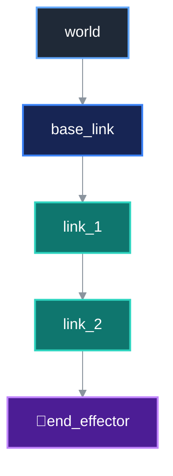
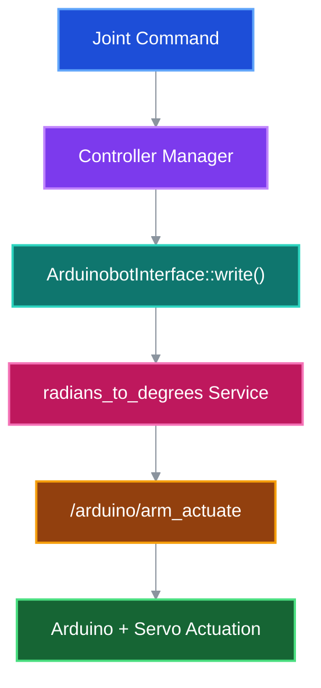

<div align="center">

# frame2motion

### *From reference frames to real motion.*

A ROS Noetic robotic arm project where **kinematics**, **robot modeling**, **simulation**, **control**, and **hardware actuation** meet in one evolving system.

<br>

<p align="center">
  
  
  
  
  
</p>

</div>

---

## Design Statement

> **frame2motion** is built around a simple but powerful idea:  
> a robot should not only **move**, it should be understood from the inside out —  
> from **mathematical frames**, to **software architecture**, to **real hardware motion**.

<br>

<table>
<tr>
<td width="33%" align="center">

### 🧭 Motion Logic
Frames, translation, rotation, homogeneous transforms, and kinematic reasoning form the mathematical backbone.

</td>
<td width="33%" align="center">

### 🤖 Robot Intelligence
URDF/Xacro modeling, ROS nodes, controllers, and simulation give structure to behavior.

</td>
<td width="33%" align="center">

### 🔩 Physical Execution
Arduino actuation, angle conversion, rosserial communication, and servo motion turn theory into action.

</td>
</tr>
</table>

---

## System Composition

<table>
<tr>
<td width="25%" align="center">

### 01  
## Reference Frames

Local and world coordinates define how the robot interprets geometry.

</td>
<td width="25%" align="center">

### 02  
## Kinematics

2D and 3D transformations describe how positions and orientations evolve.

</td>
<td width="25%" align="center">

### 03  
## ROS Control Stack

Controllers, hardware interfaces, and timing logic organize motion commands.

</td>
<td width="25%" align="center">

### 04  
## Real Hardware

The final command path reaches the Arduino and drives the servos physically.

</td>
</tr>
</table>

<br>

<div align="center">

```text
Frames  →  Kinematics  →  URDF/Xacro  →  ros_control  →  Hardware Interface  →  Arduino  →  Real Motion
```

</div>

---

## Visual Identity of the Project

<p align="center">
  
</p>

<p align="center">
  <sub>
    Suggested visual: dark premium banner with the robotic arm, reference axes, soft glow, and a clean technical atmosphere.
  </sub>
</p>

---

## Architecture Canvas

Instead of a classic diagram, the project can be read as a **layered motion architecture**:

<table>
<tr>
<td width="20%" align="center"><b>Layer</b></td>
<td width="40%" align="center"><b>Purpose</b></td>
<td width="40%" align="center"><b>Main Elements</b></td>
</tr>

<tr>
<td align="center"><b>Mathematical Layer</b></td>
<td align="center">Describes motion in terms of frames and transformations</td>
<td align="center">2D / 3D kinematics, rotation matrices, translation vectors</td>
</tr>

<tr>
<td align="center"><b>Description Layer</b></td>
<td align="center">Defines robot structure and geometry</td>
<td align="center">URDF, Xacro, links, joints, inertials, visuals</td>
</tr>

<tr>
<td align="center"><b>Simulation Layer</b></td>
<td align="center">Validates behavior in a controlled virtual environment</td>
<td align="center">Gazebo, RViz, TF, robot_state_publisher</td>
</tr>

<tr>
<td align="center"><b>Control Layer</b></td>
<td align="center">Generates and manages joint commands</td>
<td align="center">controller_manager, JointTrajectoryController, hardware_interface</td>
</tr>

<tr>
<td align="center"><b>Execution Layer</b></td>
<td align="center">Bridges ROS commands to physical actuation</td>
<td align="center">ArduinobotInterface, angle converter, rosserial, Arduino servos</td>
</tr>
</table>

---

## Kinematic Atlas

Robot motion starts with one fundamental question:

> **How do we describe the same point from different reference frames?**

The project begins in 2D, where the geometry is easier to visualize, then extends the same concepts to full 3D rigid-body transformations.

---

# 2D Kinematics

<table>
<tr>
<td width="33%" align="center">

### Translation
Changes the **position**  
of a reference frame.

</td>
<td width="33%" align="center">

### Rotation
Changes the **orientation**  
of a reference frame.

</td>
<td width="33%" align="center">

### Roto-Translation
Changes **position + orientation**  
at the same time.

</td>
</tr>
</table>

---

### 2D Translation

Assume a point \(P\) is known in a local frame \(L\).

The world-frame position is obtained by adding the displacement of the local origin:

```math
\mathbf{p}_W =
\begin{bmatrix}
P_x \\
P_y
\end{bmatrix}
=
\begin{bmatrix}
L_x \\
L_y
\end{bmatrix}
+
\begin{bmatrix}
P'_x \\
P'_y
\end{bmatrix}
```

or more compactly:

```math
\boxed{
\mathbf{p}_W = \mathbf{p}_L + \mathbf{t}
}
```

with

```math
\mathbf{t} =
\begin{bmatrix}
L_x \\
L_y
\end{bmatrix}
```

> **Translation changes the origin of the frame, but the axes remain parallel.**

---

### 2D Rotation

Now suppose the local frame is rotated by an angle \(\beta\).

The corresponding rotation matrix is:

```math
\mathbf{R}(\beta)=
\begin{bmatrix}
\cos\beta & -\sin\beta \\
\sin\beta & \cos\beta
\end{bmatrix}
```

The local coordinates are transformed into world coordinates through:

```math
\boxed{
\mathbf{p}_W =
\mathbf{R}(\beta)\,
\mathbf{p}_L
}
```

or explicitly:

```math
\begin{bmatrix}
P_x \\
P_y
\end{bmatrix}
=
\begin{bmatrix}
\cos\beta & -\sin\beta \\
\sin\beta & \cos\beta
\end{bmatrix}
\begin{bmatrix}
P'_x \\
P'_y
\end{bmatrix}
```

> **Rotation changes the orientation of the frame while preserving its origin.**

---

### 2D Roto-Translation

A real robotic frame will usually be both **translated** and **rotated**.

The transformation becomes:

```math
\boxed{
\mathbf{p}_W =
\mathbf{R}\mathbf{p}_L + \mathbf{t}
}
```

Instead of handling rotation and translation separately, homogeneous coordinates combine both into a single matrix:

```math
\begin{bmatrix}
P_x \\
P_y \\
1
\end{bmatrix}
=
\underbrace{
\begin{bmatrix}
\cos\beta & -\sin\beta & L_x \\
\sin\beta &  \cos\beta & L_y \\
0         & 0          & 1
\end{bmatrix}
}_{\text{Homogeneous Transformation}}
\begin{bmatrix}
P'_x \\
P'_y \\
1
\end{bmatrix}
```

The matrix can be read visually as:

```math
\mathbf{T}=
\begin{bmatrix}
\color{#58a6ff}{r_{11}} & \color{#58a6ff}{r_{12}} & \color{#58a6ff}{r_{13}} & \color{#f778ba}{L_x} \\
\color{#58a6ff}{r_{21}} & \color{#58a6ff}{r_{22}} & \color{#58a6ff}{r_{23}} & \color{#f778ba}{L_y} \\
\color{#58a6ff}{r_{31}} & \color{#58a6ff}{r_{32}} & \color{#58a6ff}{r_{33}} & \color{#f778ba}{L_z} \\
0 & 0 & 0 & 1
\end{bmatrix}
```

- **Blue block** → rotation
- **Red column** → translation
- **Last row** → homogeneous form


---

# 3D Kinematics

The same idea extends naturally to three dimensions.

A point now has three coordinates:

```math
\mathbf{p} =
\begin{bmatrix}
P_x \\
P_y \\
P_z
\end{bmatrix}
```

and a reference frame can rotate independently around the **X**, **Y**, and **Z** axes.

---

### 3D Translation

The position of a point expressed in the world frame becomes:

```math
\mathbf{p}_W =
\begin{bmatrix}
P_x \\
P_y \\
P_z
\end{bmatrix}
=
\begin{bmatrix}
L_x \\
L_y \\
L_z
\end{bmatrix}
+
\begin{bmatrix}
P'_x \\
P'_y \\
P'_z
\end{bmatrix}
```

or:

```math
\boxed{
\mathbf{p}_W = \mathbf{p}_L + \mathbf{t}
}
```

with

```math
\mathbf{t} =
\begin{bmatrix}
L_x \\
L_y \\
L_z
\end{bmatrix}
```

---

### 3D Rotation

Three elementary rotation matrices describe rotations around the principal axes.

#### Rotation around X

```math
\mathbf{R}_x(\gamma)=
\begin{bmatrix}
1 & 0 & 0 \\
0 & \cos\gamma & -\sin\gamma \\
0 & \sin\gamma & \cos\gamma
\end{bmatrix}
```

#### Rotation around Y

```math
\mathbf{R}_y(\beta)=
\begin{bmatrix}
\cos\beta & 0 & \sin\beta \\
0 & 1 & 0 \\
-\sin\beta & 0 & \cos\beta
\end{bmatrix}
```

#### Rotation around Z

```math
\mathbf{R}_z(\alpha)=
\begin{bmatrix}
\cos\alpha & -\sin\alpha & 0 \\
\sin\alpha & \cos\alpha & 0 \\
0 & 0 & 1
\end{bmatrix}
```

For the rotation convention used here, the combined orientation is:

```math
\boxed{
\mathbf{R}
=
\mathbf{R}_z(\alpha)
\mathbf{R}_y(\beta)
\mathbf{R}_x(\gamma)
}
```

> Matrix multiplication order matters: 3D rotations are generally **not commutative**.

---

### 3D Homogeneous Transformation

A complete rigid-body transformation combines:

- a `3 × 3` rotation matrix
- a `3 × 1` translation vector

into one `4 × 4` matrix:

```math
{}^{W}\mathbf{T}_{L} =
\begin{bmatrix}
r_{11} & r_{12} & r_{13} & L_x \\
r_{21} & r_{22} & r_{23} & L_y \\
r_{31} & r_{32} & r_{33} & L_z \\
0      & 0      & 0      & 1
\end{bmatrix}
```

A point represented in the local frame can therefore be expressed in the world frame using:

```math
\boxed{
\begin{bmatrix}
P_x \\
P_y \\
P_z \\
1
\end{bmatrix}
=
{}^{W}\mathbf{T}_{L}
\begin{bmatrix}
P'_x \\
P'_y \\
P'_z \\
1
\end{bmatrix}
}
```

In compact notation:

```math
\boxed{
{}^{W}\mathbf{p}
=
{}^{W}\mathbf{T}_{L}
\,{}^{L}\mathbf{p}
}
```

---

### Why this matters for the robot

The robot is not described by one transformation, but by a **chain of coordinate frames**.

### Frame Chain



The transformation from the world frame to the end effector is obtained by chaining the transformations:

```math
{}^{W}\mathbf{T}_{E}
=
{}^{W}\mathbf{T}_{1}
{}^{1}\mathbf{T}_{2}
{}^{2}\mathbf{T}_{3}
\cdots
{}^{n}\mathbf{T}_{E}
```

This is the mathematical foundation behind **forward kinematics**, TF trees, and robot motion in ROS.

---

## Motion-to-Hardware Flow

<table>
<tr>
<td width="16%" align="center"><b>Trajectory</b></td>
<td width="16%" align="center"><b>Controller</b></td>
<td width="16%" align="center"><b>Hardware Interface</b></td>
<td width="16%" align="center"><b>Angle Conversion</b></td>
<td width="16%" align="center"><b>ROS ↔ Arduino</b></td>
<td width="20%" align="center"><b>Servo Motion</b></td>
</tr>

<tr>
<td align="center">Desired joint motion is defined</td>
<td align="center">ros_control computes command outputs</td>
<td align="center">Commands are exposed through the interface</td>
<td align="center">Radians are converted into servo-friendly degrees</td>
<td align="center">Messages are sent through rosserial</td>
<td align="center">The physical robot executes the movement</td>
</tr>
</table>

<br>

<div align="center">

### Motion Command Pipeline



</div>

---

## Project Structure

```
frame2motion/
├── README.md
├── assets/
│   ├── hero/
│   ├── kinematics/
│   ├── diagrams/
│   └── gallery/
├── arduinobot_description/
│   ├── launch/
│   ├── mesh/
│   ├── rviz/
│   └── urdf/
├── arduinobot_controller/
│   ├── config/
│   ├── include/
│   ├── launch/
│   ├── src/
│   └── srv/
└── arduinobot_test/
```

---

## Selected Technical Concepts

<table>
<tr>
<td width="50%">

### Robot Description
- Links and joints
- Xacro properties and macros
- Mesh placement
- Materials and visuals
- Collision and inertial blocks

</td>
<td width="50%">

### Control Logic
- `hardware_interface::RobotHW`
- `JointStateInterface`
- `PositionJointInterface`
- `controller_manager`
- timer-based update loop

</td>
</tr>

<tr>
<td width="50%">

### Motion Conversion
- ROS joint commands in radians
- custom conversion service
- real-servo degree mapping
- URDF limit interpretation

</td>
<td width="50%">

### Simulation & Validation
- RViz visualization
- Gazebo spawning
- robot_state_publisher
- controllers YAML configuration
- ROS topic/service orchestration

</td>
</tr>
</table>

---

## Code Snapshots

### Angle conversion service

```cpp
bool convert_radians_to_degrees(
    arduinobot_controller::AnglesConverter::Request  &req,
    arduinobot_controller::AnglesConverter::Response &res)
{
    res.base     = static_cast<int>(((req.base + (M_PI/2)) * 180) / M_PI);
    res.shoulder = 180 - static_cast<int>(((req.shoulder + (M_PI/2)) * 180) / M_PI);
    res.elbow    = static_cast<int>(((req.elbow + (M_PI/2)) * 180) / M_PI);
    res.gripper  = static_cast<int>(((-req.gripper) * 180) / (M_PI/2));
    return true;
}
```

### Hardware interface update loop

```cpp
void ArduinobotInterface::update(const ros::TimerEvent& e)
{
    elapsed_time_ = ros::Duration(e.current_real - e.last_real);
    read();
    controller_manager_->update(ros::Time::now(), elapsed_time_);
    write(elapsed_time_);
}
```

### Launch philosophy

```xml
<group unless="$(arg is_sim)">
    <node pkg="arduinobot_controller"
          type="angles_converter_cpp"
          name="angles_converter"
          output="screen"/>

    <node pkg="arduinobot_controller"
          type="arduinobot_interface_node"
          name="arduinobot_interface_node"
          ns="/arduinobot"
          output="screen"/>
</group>
```

---

## Technology Canvas

<p align="center">
  
  
  
  
  
  
  
  
  
  
  
  
</p>

---

## Gallery

<table>
<tr>
<td align="center" width="50%">
  <br>
  <b>RViz robot visualization</b>
</td>
<td align="center" width="50%">
  <br>
  <b>Gazebo simulation environment</b>
</td>
</tr>
<tr>
<td align="center" width="50%">
  <br>
  <b>Robot description and frame structure</b>
</td>
<td align="center" width="50%">
  <br>
  <b>Software-to-hardware communication path</b>
</td>
</tr>
</table>

---

## Author

<div align="center">

**Mohamed Reda**  
Embedded Systems & Control Engineering Student  
Robotics • Embedded Software • ROS • Simulation • Control • Hardware Integration

</div>
