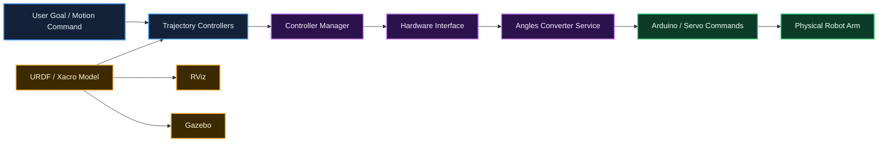
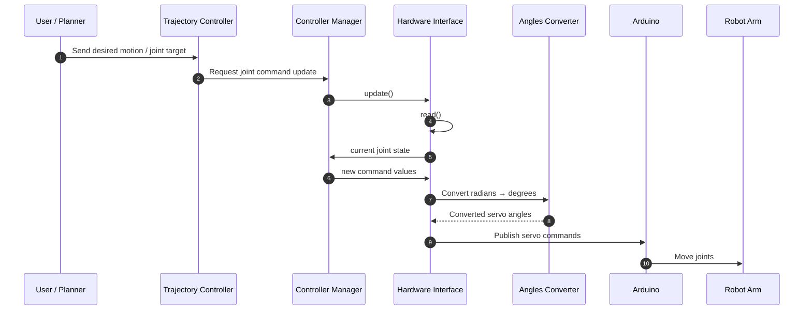
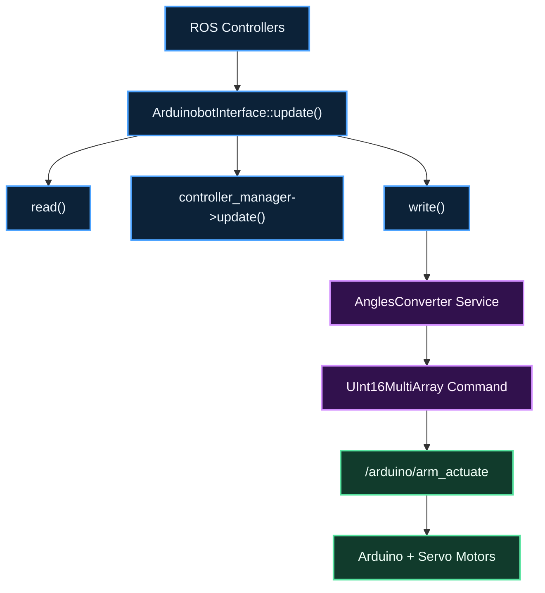
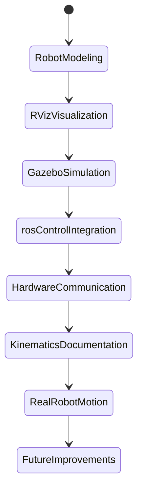

<div align="center">

# frame2motion

### *From reference frames to real motion.*

An evolving robotics project exploring the complete path from  
**kinematics and frame transformations** to **ROS control, simulation, and real hardware actuation**.

<p align="center">
  
  
  
  
  
</p>

</div>

---

## Overview

**frame2motion** is a documentation-first robotics project built around a robotic arm developed in the **ROS Noetic** ecosystem.

The goal is not only to make the robot move, but to understand the full chain behind that motion:

- how a robot is described with **URDF / Xacro**
- how joints are visualized in **RViz**
- how the robot behaves in **Gazebo**
- how **ros_control** abstracts the hardware layer
- how **services, controllers, and interfaces** connect software to the real robot
- how **2D and 3D kinematics** explain motion mathematically

This repository is currently evolving and serves as both:

- an **engineering notebook**
- a **technical documentation space**
- a **future code base** for the complete robotic arm stack

---

## Visual Preview

> Replace these placeholders later with your real screenshots / renders.

<p align="center">
  
</p>

<p align="center">
  
  
</p>

---

## Project Philosophy

> This project is about bridging **mathematical motion**, **robot software**, and **real-world actuation**.

```text
Reference Frames
      ↓
Kinematics
      ↓
Robot Model (URDF/Xacro)
      ↓
Controllers (ros_control)
      ↓
Hardware Interface
      ↓
Arduino + Servos
      ↓
Real Motion
```

---

## System Architecture



---

## Repository Vision

This repository is being built progressively around three major layers:

| Layer | Purpose | Main Tools |
|------|---------|------------|
| **Modeling** | Describe the robot structure and joints | URDF, Xacro |
| **Simulation & Visualization** | Observe the robot in virtual environments | RViz, Gazebo |
| **Control & Hardware** | Send motion commands to the real arm | ros_control, controller_manager, Arduino |

---

## Workspace Structure

```text
frame2motion/
├── README.md
├── assets/
│   ├── hero-rviz.png
│   ├── gazebo-view.png
│   ├── hardware-setup.png
│   ├── kinematics-2d.png
│   ├── kinematics-3d.png
│   └── architecture-overview.png
├── src/
│   ├── arduinobot_description/
│   │   ├── launch/
│   │   ├── mesh/
│   │   ├── rviz/
│   │   └── urdf/
│   ├── arduinobot_controller/
│   │   ├── config/
│   │   ├── include/
│   │   ├── launch/
│   │   ├── src/
│   │   └── srv/
│   └── arduinobot_test/
└── docs/
    ├── notes.md
    ├── architecture.md
    └── kinematics.md
```

---

## Core ROS Flow



---

## Robot Modeling

The robot is described using **URDF/Xacro**, where each link and joint defines the mechanical structure of the arm.

This modeling stage includes:

- links and joints
- visual and collision geometry
- inertial placeholders
- materials / colors
- transmissions
- gazebo plugins
- mimic joints for the gripper

### Why this matters

URDF/Xacro is the **foundation** of the project.  
Without a correct robot model:

- RViz cannot display the robot properly
- Gazebo cannot simulate it correctly
- controllers cannot use the expected joint structure

---

## Control Stack

The control architecture relies on:

- **`controller_manager`**
- **`hardware_interface`**
- **`JointStateInterface`**
- **`PositionJointInterface`**
- **trajectory controllers**
- a custom **angles conversion service**
- a custom **robot hardware interface node**

### Controller Configuration Example

```yaml
arduinobot:

  arm_controller:
    type: "position_controllers/JointTrajectoryController"
    joints:
      - joint_1
      - joint_2
      - joint_3

  gripper_controller:
    type: "position_controllers/JointTrajectoryController"
    joints:
      - joint_4
```

### What it means

- the **arm controller** commands the 3 main joints
- the **gripper controller** commands the gripper joint
- `JointTrajectoryController` is a predefined ROS controller plugin
- it receives trajectory goals and computes smooth joint motion over time

---

## Hardware Interface Logic

The project uses a custom hardware interface to bridge **ROS** and the **Arduino-based robot**.

### Main idea

The controller manager does not directly talk to the Arduino.

Instead:

1. ROS controllers compute desired joint commands
2. the hardware interface reads/writes those commands
3. the angles are converted from **radians** to **servo-friendly degrees**
4. the command is published to the Arduino



---

## Angle Conversion Service

A dedicated ROS service is used to convert angles between:

- **ROS / URDF convention** → radians
- **Arduino / servo convention** → degrees

### Service role

This is essential because:

- motion planning and controllers work naturally in **radians**
- hobby servos are usually driven in **degrees**
- joint limits may require offsets or sign changes

### Example Service Definition

```srv
float64 base
float64 shoulder
float64 elbow
float64 gripper
---
float64 base
float64 shoulder
float64 elbow
float64 gripper
```

---

## Kinematics Foundation

This project also studies the mathematical side of robotics, beginning with **2D** and extending to **3D** transformations.

### Topics covered

- translation
- rotation
- roto-translation
- local vs world frames
- homogeneous transformation matrices

---

## 2D Kinematics

In 2D, the motion of a point or frame can be understood through:

### 1. Translation
Moving a frame without changing its orientation.

### 2. Rotation
Changing the orientation of a frame around an origin.

### 3. Roto-Translation
Combining translation and rotation in one transformation.

<p align="center">
  
</p>

### 2D Homogeneous Transformation

\[
T =
\begin{bmatrix}
\cos(\beta) & -\sin(\beta) & L_x \\
\sin(\beta) & \cos(\beta) & L_y \\
0 & 0 & 1
\end{bmatrix}
\]

This matrix combines:

- a **rotation matrix**
- a **translation vector**

into one compact representation.

---

## 3D Kinematics

In 3D, things become richer because rotations can happen around different axes:

- **Rotation around Z** → \(R_z(\alpha)\)
- **Rotation around Y** → \(R_y(\beta)\)
- **Rotation around X** → \(R_x(\gamma)\)

<p align="center">
  
</p>

### 3D Homogeneous Transformation

\[
T =
\begin{bmatrix}
r_{11} & r_{12} & r_{13} & L_x \\
r_{21} & r_{22} & r_{23} & L_y \\
r_{31} & r_{32} & r_{33} & L_z \\
0 & 0 & 0 & 1
\end{bmatrix}
\]

This matrix allows the robot to express a point from one coordinate frame into another.

---

## Development Progress



---

## Current Status

- [x] Robot modeled with URDF/Xacro
- [x] RViz visualization working
- [x] Gazebo simulation launched
- [x] Basic controllers configured
- [x] Hardware interface structure implemented
- [x] Angle conversion service implemented
- [x] 2D / 3D kinematics notes started
- [ ] Closed-loop feedback integration
- [ ] Better dynamic modeling
- [ ] End-effector task-space control
- [ ] Complete project publication

---

## Learning Outcomes

This project is helping me build hands-on understanding of:

- coordinate frames
- transformation matrices
- ROS computation flow
- service/client architecture
- controller abstraction
- hardware/software interfacing
- robotic arm actuation
- simulation-to-reality thinking

---

## Why this repository exists

I created this repository not just to store code, but to document the **engineering journey** behind the project.

It is meant to capture:

- what the robot does
- how the software is organized
- why each ROS component exists
- how theory translates into implementation

---

## Roadmap

```text
[1] Clean robot model
        ↓
[2] Stable simulation
        ↓
[3] Controller integration
        ↓
[4] Hardware interface
        ↓
[5] Real servo motion
        ↓
[6] Deeper kinematics & control
        ↓
[7] Full public release
```

---

## Technologies Used

- **ROS Noetic**
- **RViz**
- **Gazebo**
- **URDF / Xacro**
- **ros_control**
- **controller_manager**
- **hardware_interface**
- **Arduino**
- **rosserial**
- **C++**
- **YAML**
- **Linux / Docker**

---

## Author

**Mohamed Reda**  
Embedded Systems & Control Engineering Student  
Interested in robotics, embedded systems, control, PCB design, and real-world engineering systems.

<p align="left">
  <a href="https://github.com/bk201-dev">GitHub</a> •
  <a href="https://linkedin.com/in/mohamed-reda-ez-zouhry">LinkedIn</a>
</p>

---

## Final Note

This repository is still under active development.  
Some modules are already implemented, while others are being refined, documented, or prepared for publication.

If you are visiting this repo early: welcome — you are seeing the project while it is still becoming what it was designed to be.

---
