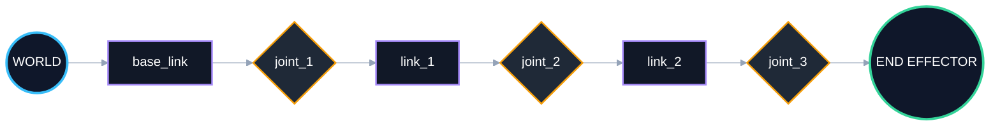
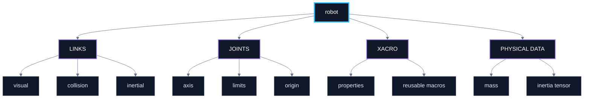

```mermaid
%%{init: {"theme":"base","themeVariables":{"background":"#0d1117","primaryTextColor":"#f8fafc","lineColor":"#64748b"}}}%%
flowchart LR
    subgraph MATH["MOTION MODEL"]
        F["Reference Frames"] --> K["Kinematics"] --> TF["TF / Transforms"]
    end
    subgraph DIGITAL["DIGITAL TWIN"]
        U["URDF / Xacro"] --> R["RViz"]
        U --> G["Gazebo"]
    end
    subgraph CONTROL["ROS CONTROL"]
        J["Joint Commands"] --> CM["controller_manager"] --> HI["Hardware Interface"]
    end
    subgraph REAL["PHYSICAL ARM"]
        C["Angle Conversion"] --> RS["rosserial"] --> A["Arduino"] --> S["Servo Motion"]
    end

    TF --> U
    R --> J
    G --> J
    HI --> C

    classDef math fill:#111827,stroke:#38bdf8,color:#f8fafc,stroke-width:2px;
    classDef digital fill:#111827,stroke:#a78bfa,color:#f8fafc,stroke-width:2px;
    classDef control fill:#111827,stroke:#f59e0b,color:#f8fafc,stroke-width:2px;
    classDef real fill:#111827,stroke:#34d399,color:#f8fafc,stroke-width:2px;
    class F,K,TF math;
    class U,R,G digital;
    class J,CM,HI control;
    class C,RS,A,S real;
```

<div align="center">


<br>

# frame2motion

### **From coordinate frames to physical motion.**

A ROS Noetic robotic-arm project connecting  
**kinematics → robot description → simulation → control → real servo actuation**

<br>

<p align="center">
  
  
  
  
  
</p>
<p align="center">
  
  
</p>

<br>

> **A robot arm is not one mechanism. It is a chain of frames, transforms, software layers, commands and actuators — all agreeing on what “move” means.**

> NOTE :
> This repository documents a robotic arm project currently under development.  
> Some files, implementations, and validation results will be added later as the project progresses and becomes more finalized.

---


</div>

---


<h2 align="center">◈ The Motion Chain</h2>

<p align="center">
  This project follows a full motion pipeline, starting from geometric understanding and ending with physical robot actuation.
</p>

<br>

<table align="center">
  <tr>
    <td align="center" width="180">
      <h3>01</h3>
      <b>FRAME</b><br><br>
      <sub>Where is it?</sub>
    </td>
    <td align="center" width="180">
      <h3>02</h3>
      <b>TRANSFORM</b><br><br>
      <sub>How does it move?</sub>
    </td>
    <td align="center" width="180">
      <h3>03</h3>
      <b>MODEL</b><br><br>
      <sub>What is connected?</sub>
    </td>
    <td align="center" width="180">
      <h3>04</h3>
      <b>CONTROL</b><br><br>
      <sub>What should move?</sub>
    </td>
    <td align="center" width="180">
      <h3>05</h3>
      <b>ACTUATE</b><br><br>
      <sub>Make it real.</sub>
    </td>
  </tr>
</table>

<br>

<p align="center">

`REFERENCE FRAME` → `KINEMATICS` → `URDF / XACRO` → `ROS CONTROL` → `ARDUINO` → `SERVO MOTION`

</p>

<br>

<h2 align="center">◈ System Choreography</h2>

<p align="center">
Instead of treating simulation, ROS control and hardware as separate topics, <b>frame2motion</b> follows one continuous motion path.
</p>



---

<h1 align="center">Kinematic Atlas</h1>

<h2 align="center">01 — One point, two frames</h2>

<p align="center">Everything begins with one question:</p>

<p align="center"><b>How can the same physical point have different coordinates depending on the frame observing it?</b></p>

<p align="center">
  The project starts in 2D to build intuition, then extends the same ideas to 3D rigid-body motion.
</p>

<br>

<table align="center">
<tr>

<td align="center" width="250">

<sub>01</sub>

<h3 align="center">Translation</h3>

**Position Shift**

<br>

<code>p<sup>W</sup> = p<sup>L</sup> + t</code>

</td>

<td align="center" width="250">

<sub>02</sub>

<h3 align="center">Rotation</h3>

**Orientation Change**

<br>

<code>p<sup>W</sup> = R p<sup>L</sup></code>

</td>

<td align="center" width="250">

<sub>03</sub>

<h3 align="center">Rigid Transform</h3>

**Position + Orientation**

<br>

<code>p<sup>W</sup> = R p<sup>L</sup> + t</code>

</td>

</tr>
</table>

<br>
<details>
<summary><b> Open the 2D derivation</b></summary>

<h3 align="center">Translation</h3>

```math
\boxed{
\mathbf{p}_W=\mathbf{p}_L+\mathbf{t}
}
```

<h3 align="center">Rotation</h3>

```math
\mathbf{R}(\beta)=
\begin{bmatrix}
\cos\beta & -\sin\beta \\
\sin\beta & \cos\beta
\end{bmatrix}
```

```math
\boxed{
\mathbf{p}_W=\mathbf{R}(\beta)\mathbf{p}_L
}
```

<h3 align="center">Homogeneous transformation</h3>

```math
\boxed{
{}^{W}\mathbf{T}_{L}=
\begin{bmatrix}
\cos\beta & -\sin\beta & L_x \\
\sin\beta &  \cos\beta & L_y \\
0 & 0 & 1
\end{bmatrix}
}
```

</details>

---

<h2 align="center">02 — From the plane to 3D</h2>

<details>
<summary><b> Open the 3D rotation matrices</b></summary>

<h3 align="center">Rotation around X</h3>

```math
\mathbf{R}_x(\gamma)=
\begin{bmatrix}
1 & 0 & 0 \\
0 & \cos\gamma & -\sin\gamma \\
0 & \sin\gamma & \cos\gamma
\end{bmatrix}
```

<h3 align="center">Rotation around Y</h3>

```math
\mathbf{R}_y(\beta)=
\begin{bmatrix}
\cos\beta & 0 & \sin\beta \\
0 & 1 & 0 \\
-\sin\beta & 0 & \cos\beta
\end{bmatrix}
```

<h3 align="center">Rotation around Z</h3>

```math
\mathbf{R}_z(\alpha)=
\begin{bmatrix}
\cos\alpha & -\sin\alpha & 0 \\
\sin\alpha & \cos\alpha & 0 \\
0 & 0 & 1
\end{bmatrix}
```

```math
\boxed{
\mathbf{R}
=
\mathbf{R}_z(\alpha)
\mathbf{R}_y(\beta)
\mathbf{R}_x(\gamma)
}
```

> Rotation order matters — 3D rotations are generally **not commutative**.

</details>

<h3 align="center">3D rigid-body transform</h3>

```math
{}^{W}\mathbf{T}_{L} =
\begin{bmatrix}
r_{11} & r_{12} & r_{13} & L_x \\
r_{21} & r_{22} & r_{23} & L_y \\
r_{31} & r_{32} & r_{33} & L_z \\
0 & 0 & 0 & 1
\end{bmatrix}
```

---

<h2 align="center">03 — A robot is a chain of frames</h2>



```math
{}^{W}\mathbf{T}_{E}
=
{}^{W}\mathbf{T}_{1}
{}^{1}\mathbf{T}_{2}
{}^{2}\mathbf{T}_{3}
\cdots
{}^{n}\mathbf{T}_{E}
```

<p align="center">
This is the mathematical backbone behind <b>forward kinematics</b>, <b>TF trees</b>, and pose propagation in ROS.
</p>

---

<h1 align="center">Robot Description</h1>

<h2 align="center">◈ URDF / Xacro as the robot's structural language</h2>



<p align="center">
  
</p>

---

<h1 align="center">Simulation Layer</h1>

<table align="center">
<tr>
<td width="50%" align="center">
<h2>RViz</h2>
<b>Geometry + TF + state visualization</b><br><br>

</td>
<td width="50%" align="center">
<h2>Gazebo</h2>
<b>Physics + spawning + controller integration</b><br><br>

</td>
</tr>
</table>

---

<h1 align="center">From ROS to Real Motion</h1>

<p align="center"><b>The interesting moment is when software stops describing motion and starts causing it.</b></p>


<h1 align="center">Control Core</h1>

<h2 align="center">Hardware interface loop</h2>

```cpp
void ArduinobotInterface::update(const ros::TimerEvent& e)
{
    elapsed_time_ = ros::Duration(e.current_real - e.last_real);
    read();
    controller_manager_->update(ros::Time::now(), elapsed_time_);
    write(elapsed_time_);
}
```

```text
READ STATE  ──►  UPDATE CONTROLLERS  ──►  WRITE COMMANDS
```

<h2 align="center">Angle conversion</h2>

```cpp
bool convert_radians_to_degrees(
    arduinobot_controller::AnglesConverter::Request  &req,
    arduinobot_controller::AnglesConverter::Response &res)
{
    res.base     = static_cast<int>(((req.base + (M_PI/2)) * 180) / M_PI);
    res.shoulder = 180 - static_cast<int>(((req.shoulder + (M_PI/2)) * 180) / M_PI);
    res.elbow    = static_cast<int>(((req.elbow + (M_PI/2)) * 180) / M_PI);
    res.gripper  = static_cast<int>(((-req.gripper) * 180) / (M_PI/2));
    return true;
}
```

<h2 align="center">Simulation / hardware split</h2>

```xml
<group unless="$(arg is_sim)">
    <node pkg="arduinobot_controller"
          type="angles_converter_cpp"
          name="angles_converter"
          output="screen"/>

    <node pkg="arduinobot_controller"
          type="arduinobot_interface_node"
          name="arduinobot_interface_node"
          ns="/arduinobot"
          output="screen"/>
</group>
```

---

<h1 align="center">Engineering Map</h1>

<table align="center">
<tr>
<td width="50%" valign="top">
<h3>🧭 Motion Mathematics</h3>
Reference frames · 2D/3D transforms · Rotation matrices · Homogeneous transforms · Frame chaining
</td>
<td width="50%" valign="top">
<h3>🤖 Robot Modeling</h3>
URDF links/joints · Xacro macros · Visual/collision geometry · Joint limits · Inertial data
</td>
</tr>
<tr>
<td width="50%" valign="top">
<h3>⚙️ ROS Control</h3>
RobotHW · JointStateInterface · PositionJointInterface · controller_manager · Timer-driven update loop
</td>
<td width="50%" valign="top">
<h3>🔌 Hardware Bridge</h3>
Radian-to-degree mapping · Custom service · rosserial · Arduino actuation · Servo command path
</td>
</tr>
</table>

---

<h1 align="center">Technology Strip</h1>

<p align="center">
  
  
  
  
  
</p>

<p align="center">
  
  
  
  
  
</p>

<p align="center">
  
  
  
</p>


<div align="center">

<h2 align="center">frame2motion</h2>

**Frames define motion. Software organizes it. Hardware makes it real.**

<br>

**Mohamed Reda**  
Embedded Systems & Control Engineering Student

`Robotics` · `Embedded Software` · `ROS` · `Simulation` · `Control` · `Hardware Integration`

</div>
